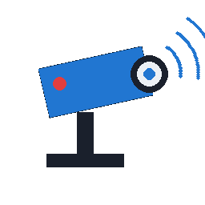
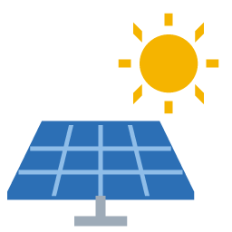
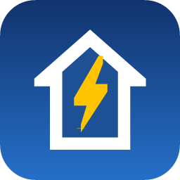
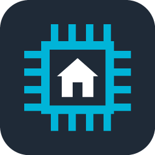

# 🏠 Plugins Jeedom — sMug

**Trente-trois plugins libres pour Jeedom, écrits en Belgique. Trente n'installent rien ; les trois autres disent pourquoi.**

Un second dashboard, une console, des écrans muraux, la TV, des caméras, un
portier, une alarme, la présence, le solaire, le compteur, le chauffage, MQTT,
ESPHome, Matter, la météo, les poubelles, les trains, les pannes de courant et
d'eau — chacun dans son dépôt, tous rassemblés ici.

---

## 📖 Ce dépôt

Ce dépôt ne contient aucun code : c'est la **porte d'entrée** vers les plugins
Jeedom publiés sous le compte [`replicatorbe`](https://github.com/replicatorbe).
Chaque plugin vit dans son propre dépôt, avec sa documentation, son changelog et,
presque toujours, ses tests. Vous trouverez ici de quoi savoir lequel vous
intéresse, et pourquoi.

Un fil conducteur : **résoudre un vrai problème de la maison sans écrire de
scénario**, et ne rien demander de plus que Jeedom — pas de paquet à installer
quand on peut s'en passer, pas de service tiers imposé, pas de cloud là où le
réseau local suffit.

Et un second, revendiqué : **combler ce qui manque aux Belges dans Jeedom**.
Cinq plugins — [Météo Belgique IRM, Hygea, SNCB/NMBS, ORES et SWDE](#-la-belgique-au-quotidien) —
n'existent que pour ça : les services belges sont rarement couverts par les
plugins existants, quand ils ne sont pas simplement absents.

---

## 🧭 Vue d'ensemble

La colonne **Version** donne la version stable (branche `master`). Quand un
plugin n'a encore qu'une version de test, elle est notée **β** : il s'installe
alors depuis la branche `beta`.

| | Plugin | En une phrase | Version | Dépôt |
|:---:|:---|:---|:---:|:---:|
|  | **jeeGlow** | Un second dashboard, moderne et tactile, sans toucher au premier | `0.1` | [↗](https://github.com/replicatorbe/jeedom-plugin-jeeglowbe) |
|  | **JeeTerm** | Un vrai terminal dans Jeedom, comme celui de Home Assistant | `0.2` | [↗](https://github.com/replicatorbe/jeedom-plugin-jeeterm) |
|  | **Calendrier des programmations** | Tout ce que Jeedom va exécuter, jour par jour, et les minutes où tout part en même temps | `1.1` | [↗](https://github.com/replicatorbe/jeedom-plugin-calendrierbe) |
|  | **ACME** | Jeedom en HTTPS, avec un certificat gratuit qui se renouvelle seul | `0.1` | [↗](https://github.com/replicatorbe/jeedom-plugin-acme) |
|  | **GlowScreen32** | Des écrans tactiles ESP32 bon marché en télécommandes murales | `3.2 β` | [↗](https://github.com/replicatorbe/jeedom-plugin-glowscreen32) |
|  | **Jeedom TV** | La maison à la télécommande de la TV, et les alertes par-dessus le film | `1.3.1` | [↗](https://github.com/replicatorbe/jeedom-plugin-jeetvbe) |
|  | **Google TV** | Piloter et suivre ses TV Google TV en local, sans adb ni Python | `0.2.0` | [↗](https://github.com/replicatorbe/jeedom-plugin-googletvbe) |
|  | **TvOverlay** | Notifications et caméra sur la TV, sans couper ce qui passe | `0.1.0` | [↗](https://github.com/replicatorbe/jeedom-plugin-tvoverlaybe) |
|  | **Sonos** | Les Sonos en local, et des annonces vocales par-dessus la musique | `0.4.0` | [↗](https://github.com/replicatorbe/jeedom-plugin-sonosbe) |
|  | **Dahua NVR** | Les événements de vos caméras Dahua, en temps réel, typés et archivés | `0.9` | [↗](https://github.com/replicatorbe/jeedom-plugin-dahua) |
|  | **Dahua VTO** | On sonne, Jeedom le sait dans la seconde et garde le visage | `0.1` | [↗](https://github.com/replicatorbe/jeedom-plugin-dahuavtobe) |
|  | **Ajax SIA** | L'alarme Ajax reçue en local, comme un centre de télésurveillance | `0.4 β` | [↗](https://github.com/replicatorbe/jeedom-plugin-ajaxsiabe) |
|  | **Presencium** | Qui est à la maison, pour de bon, et ce que la maison en fait | `1.3` | [↗](https://github.com/replicatorbe/jeedom-plugin-presencium) |
|  | **Simulation de présence** | La maison rejoue vos vraies soirées pendant que vous êtes ailleurs | `1.0` | [↗](https://github.com/replicatorbe/jeedom-plugin-simulationpresenceintelligentbe) |
|  | **Alertes BE** | Le frigo à 10 °C, de l'eau par terre : prévenu, sans un scénario par capteur | `0.4 β` | [↗](https://github.com/replicatorbe/jeedom-plugin-alertebe) |
|  | **Solplanet** | Votre production solaire en local, sans le cloud du fabricant | `0.2` | [↗](https://github.com/replicatorbe/jeedom-plugin-solplanetbe) |
|  | **HomeWizard** | Le compteur P1 et le tarif capacitaire, relevés en local | `0.1` | [↗](https://github.com/replicatorbe/jeedom-plugin-homewizardbe) |
|  | **Thermostat BE** | Chaudière et clim réversible qui ne se battent plus | `0.5 β` | [↗](https://github.com/replicatorbe/jeedom-plugin-thermostatbe) |
|  | **Airton** | La clim Airton en local, sans le cloud Tuya | `0.3.0` | [↗](https://github.com/replicatorbe/jeedom-plugin-airtonbe) |
|  | **MQTT BE** | Donnez l'adresse du broker, vos Shelly et vos balises arrivent seuls | `0.7` | [↗](https://github.com/replicatorbe/jeedom-plugin-mqttbe) |
|  | **ESPHome** | Les modules ESPHome en direct, sans Home Assistant ni MQTT | `0.1 β` | [↗](https://github.com/replicatorbe/jeedom-plugin-esphomebe) |
|  | **Matter Hub** | Jeedom dans Google Home par Matter, entièrement en local | `0.5.2 β` | [↗](https://github.com/replicatorbe/jeedom-plugin-matterhubbe) |
|  | **WLED** | Des bandes LED qui obéissent vraiment, et rendent l'éclairage d'avant | `0.3.2` | [↗](https://github.com/replicatorbe/jeedom-plugin-wledbe) |
|  | **Brother** | Le toner à recommander avant la panne | `0.2` | [↗](https://github.com/replicatorbe/jeedom-plugin-brotherbe) |
|  | **Lampes Soir & Matin** | Les lampes s'allument le soir, s'éteignent le matin. Zéro scénario | `1.3` | [↗](https://github.com/replicatorbe/jeedom-plugin-lampesoirmatinbe) |
|  | **Volets Auto** | Les volets suivent le soleil et la température, pas une heure devinée | `1.3` | [↗](https://github.com/replicatorbe/jeedom-plugin-voletautobe) |
|  | **Dreame** | Vos robots aspirateurs dans vos scénarios, sans passerelle | `0.1` | [↗](https://github.com/replicatorbe/jeedom-plugin-dreamebe) |
|  | **K2000** | Vous parlez à la maison ; elle comprend, agit et rend compte | `0.1` | [↗](https://github.com/replicatorbe/jeedom-plugin-k2000be) |
|  | 🇧🇪 **Météo Belgique IRM** | La météo officielle belge, sans compte ni clé | `0.2` | [↗](https://github.com/replicatorbe/jeedom-plugin-meteobelgiqueirm) |
|  | 🇧🇪 **Hygea** | Le calendrier des poubelles, avec le rappel la veille au soir | `0.6` | [↗](https://github.com/replicatorbe/jeedom-plugin-hygeabe) |
|  | 🇧🇪 **SNCB/NMBS** | Est-ce que je pars maintenant, et sur quelle voie ? | `1.2` | [↗](https://github.com/replicatorbe/jeedom-plugin-sncbnmbs) |
| ⚡ | 🇧🇪 **ORES** | Une panne de courant à votre adresse, signalée avant que vous alliez voir la carte | `0.1` | [↗](https://github.com/replicatorbe/jeedom-plugin-oresbe) |
| 💧 | 🇧🇪 **SWDE** | Coupure d'eau ou eau colorée annoncée dans votre commune | `0.2` | [↗](https://github.com/replicatorbe/jeedom-plugin-swdebe) |

---

## 🖥️ L'interface et l'administration

###  jeeGlow

> *Un second dashboard, moderne et tactile, sans rien changer au premier.*

Jeedom affiche des équipements ; on voudrait qu'il montre une maison. jeeGlow
ajoute un **dashboard parallèle** — le dashboard d'origine, les vues et les
designs restent en place — construit en relisant vos objets, vos équipements et
vos commandes. Il est pensé pour l'écran mural autant que pour le téléphone.

- Rangement **par fonction** — lumières, prises, volets, chauffage, sécurité, caméras, multimédia, énergie, météo… douze domaines — déduit des types génériques du cœur, parce qu'un rangement par pièce reste vide de moitié tant que les objets ne sont pas remplis
- Navigation par rail et sous-onglets, qui devient une barre en bas sur téléphone ; une vue **Accueil** dit ce qui tourne dans la maison
- **Panneau de détail** par équipement : toutes les commandes, les courbes d'historique, et le rangement dans une pièce sans quitter le dashboard
- **Le widget du plugin est affiché tel quel** quand son auteur en a écrit un : vignettes d'alerte caméra, plan d'un robot, bulletin météo
- **Mode kiosque** : plus de menu ni de barre du haut, retour à l'accueil après inactivité, atténuation de nuit
- Temps réel par le flux d'événements du cœur, droits appliqués équipement par équipement : un profil restreint ne reçoit même pas les boutons qu'il n'a pas le droit d'actionner

En beta (0.2) : une vue **Santé** — équipements qui ne répondent plus, piles
faibles, capteurs muets depuis deux jours —, le masquage élément par élément,
et les scénarios proposés comme des scènes.

**Il ne faut rien** : ni démon, ni dépendance, ni configuration. jeeGlow ne crée
aucun équipement et ne modifie aucune commande ; la seule écriture possible est
la pièce d'un équipement, par un administrateur.
📦 [`jeedom-plugin-jeeglowbe`](https://github.com/replicatorbe/jeedom-plugin-jeeglowbe)

###  JeeTerm

> *Un vrai terminal dans Jeedom, comme le Terminal de Home Assistant.*

Certaines choses se font plus vite en trois mots dans une console qu'en dix
clics : suivre un journal, relancer un service, regarder l'espace disque, éditer
un fichier. JeeTerm ouvre un **vrai shell** de la machine Jeedom dans le
navigateur — couleurs, raccourcis clavier, `nano`, `vim`, `htop` — relié par un
WebSocket qui passe par l'Apache de Jeedom : rien de plus à ouvrir sur le réseau,
et ça marche en HTTPS comme en HTTP.

- Terminal complet (xterm.js) : recherche, liens cliquables, plein écran, copier-coller même en `http://`, touches spéciales pour tablette et téléphone
- Neuf thèmes, dont **Noir** et **Phosphore vert**, et un effet **écran cathodique** rétro
- Commandes rapides personnalisables, tapées sans être validées : c'est vous qui appuyez sur Entrée
- Bannière d'accueil façon neofetch et raccourcis Jeedom : `jlog`, `jcd`, `jerr`, `jplugins`…
- Session **tmux** persistante en option, compte du shell au choix (`www-data`, `root`…)
- Réservé aux administrateurs, jeton à usage unique de 30 secondes, audit de chaque session, fermeture après inactivité — sans jamais couper une commande qui travaille

> ⚠️ **Ce plugin a des dépendances, et ne peut pas faire autrement.** Un
> terminal ne vit pas dans une requête PHP : il lui faut un démon qui tient le
> pseudo-terminal ouvert, et un relais WebSocket dans Apache. L'installation des
> dépendances ajoute donc `python3` et `tmux` s'ils manquent, active les modules
> Apache `proxy` et `proxy_wstunnel`, et écrit
> `/etc/apache2/conf-available/jeeterm.conf` — configuration vérifiée avant
> chaque rechargement d'Apache et retirée à la désactivation du plugin. Le
> démon est en **Python avec la seule bibliothèque standard** : aucun `pip`,
> aucun environnement virtuel.

**Il faut** l'Apache de Jeedom (organisation Debian) et un profil administrateur.
Ce terminal donne un accès root à la machine : `www-data` a `sudo` sans mot de
passe sur Jeedom.
📦 [`jeedom-plugin-jeeterm`](https://github.com/replicatorbe/jeedom-plugin-jeeterm)

###  Calendrier des programmations

> *Tout ce que Jeedom va exécuter, et quand — sans ouvrir les scénarios un par un.*

Au bout de quelques années, plus personne ne sait ce qui tourne à 3 h du matin.
Le plugin rassemble sur une seule page, en vue mois, semaine ou jour, les
scénarios programmés, les blocs A et DANS en attente, les tâches des plugins et
du cœur, les fonctions `cron` des plugins. Les heures sont calculées avec la
bibliothèque cron du cœur, donc avec les mêmes règles que lui, changement
d'heure compris.

- Catégories filtrables, recherche, lien direct vers le scénario ou l'équipement
- Les tâches très fréquentes résumées en une ligne, pour garder la page lisible
- **Pics de charge** : les minutes où cinq tâches ou plus partent ensemble sont signalées
- Ce qui est estimé, en retard, en échec, ou ce qui ne partira pas — avec la raison
- Une méthode `calendrierbeEvents()` pour qu'un autre plugin y publie son propre planning

**Il ne faut rien.** Le plugin ne modifie rien : il lit. Ni démon, ni
dépendance, ni appel réseau.
📦 [`jeedom-plugin-calendrierbe`](https://github.com/replicatorbe/jeedom-plugin-calendrierbe)

###  ACME (Let's Encrypt)

> *Jeedom en HTTPS, avec un certificat gratuit qui se renouvelle sans vous.*

Un Jeedom en `http://` fait circuler le mot de passe administrateur en clair, et
le navigateur lui refuse le micro, la caméra et les notifications. Le plugin
parle lui-même le protocole ACME, en PHP, sans certbot ni acme.sh : il obtient
le certificat chez Let's Encrypt ou ZeroSSL, l'installe dans Apache et le
renouvelle.

- Validation **DNS-01 par l'API OVHcloud** : aucun port à ouvrir, wildcard possible, valable pour un Jeedom qui n'est pas exposé — ou HTTP-01 par le port 80
- Bouton « Tester » qui fait une émission complète sur le serveur de test, sans brûler les limites de Let's Encrypt
- Installation dans Apache avec sauvegarde, test de la configuration et retour arrière automatique si le test échoue
- Renouvellement quotidien au dernier tiers de la durée de vie, alerte sous 14 jours, et une sonde qui vérifie que c'est bien le bon certificat qui est servi
- Notifications (mail, Telegram, SMS, scénario) sur les événements qui comptent

**Il faut** un nom de domaine à vous, et une zone DNS chez OVHcloud pour la
validation DNS. Aucune dépendance. Le plugin parle à l'autorité de certification
et à l'API OVH, rien d'autre.
📦 [`jeedom-plugin-acme`](https://github.com/replicatorbe/jeedom-plugin-acme)

---

## 📺 Écrans, TV et son

###  GlowScreen32

> *Des écrans tactiles ESP32 bon marché, en télécommandes murales pour Jeedom.*

Les cartes « Cheap Yellow Display » (ESP32-2432S028) portent un écran tactile
de 2,8 pouces et ne coûtent presque rien. Flashées avec le
[firmware compagnon](https://github.com/replicatorbe/glowscreen32-firmware),
elles deviennent des panneaux de commande : jusqu'à 32 tuiles sur quatre pages,
qui réagissent en une seconde environ. C'est la carte qui appelle Jeedom, et
Jeedom ne répond que quand un état change.

- Tuiles action, interrupteur (lit l'état et joue l'inverse), navigation, valeur — avec un sens (ok, attention, alerte) et « — » quand la donnée est périmée
- Ordres depuis un scénario : message, changement de page, identification, redémarrage, calibration
- Diagnostic de chaque écran : Wi-Fi, mémoire, temps de fonctionnement, cause du dernier redémarrage
- Mise à jour du firmware par le réseau, sous double verrou fermé par défaut, avec retour arrière côté carte
- Une carte inconnue affiche sa propre adresse : l'enrôlement se fait sans câble

**Il faut** une carte ESP32-2432S028 et le firmware du dépôt compagnon. Ni démon,
ni dépendance, ni appel sortant.
📦 [`jeedom-plugin-glowscreen32`](https://github.com/replicatorbe/jeedom-plugin-glowscreen32)

###  Jeedom TV

> *La maison à la télécommande de la TV, et Jeedom qui parle par-dessus le film.*

Le plugin est le côté serveur de l'application Android TV
[Jeedom TV](https://github.com/replicatorbe/JeedomTvGoogleBE). Il sert des
pages de tuiles qu'on parcourt avec les flèches de la télécommande, et pousse
sur l'écran les alertes et les questions de Jeedom, par-dessus n'importe quelle
application. Chaque TV a sa propre clé, et ne peut actionner que les tuiles
qu'elle affiche : une clé volée ne pilote pas toute la maison.

- Pages de tuiles (interrupteur, volet, curseur, scénario, liste de choix), générables à partir des types génériques
- Barre d'état permanente — heure, indicateurs — par-dessus toutes les applications
- Notifications avec image ou **flux vidéo** de caméra, au format de TvOverlay
- Bloc scénario « Demander » : une question à choix sur la TV, la réponse dans une variable
- Page « Tableau des trains » lue dans le plugin SNCB/NMBS

**Il faut** une TV Android TV / Google TV et l'application compagnon. Ni démon,
ni dépendance ; tout reste sur le réseau local.
📦 [`jeedom-plugin-jeetvbe`](https://github.com/replicatorbe/jeedom-plugin-jeetvbe)

###  Google TV

> *Piloter et suivre ses TV Google TV depuis Jeedom, sans cloud, sans adb, sans Python.*

Un démon garde avec chaque TV une connexion **Google Cast** ouverte : la TV y
annonce d'elle-même le volume, la veille, l'application en cours, la lecture.
Après un appairage par code, le plugin parle aussi le protocole de télécommande
Android TV, réécrit en PHP. Ce qu'on fait au canapé se voit dans Jeedom dans la
seconde.

- Widget en forme de télécommande, à jour en direct
- Touches, sources HDMI, allumage par le réseau (Wake-on-LAN), marche/arrêt selon l'état réel de la TV
- Lancement d'applications par liste, par lien ou par nom de paquet
- Recherche des TV sur le réseau, ou ajout par adresse
- Relance de TvOverlay quand Android l'a arrêtée

**Il faut** une TV Google TV / Android TV sur le réseau local. Démon PHP, aucune
dépendance.
📦 [`jeedom-plugin-googletvbe`](https://github.com/replicatorbe/jeedom-plugin-googletvbe)

###  TvOverlay

> *Les notifications de Jeedom et le flux d'une caméra sur la TV, sans couper le film.*

Le plugin parle à l'application Android TV **TvOverlay**, disponible sur le Play
Store, sur le réseau local. Au-delà des notifications, il gère des
**indicateurs automatiques** : une icône qui apparaît quand la porte du garage
est ouverte, un texte tiré d'une commande, sans écrire un scénario.

- Notifications simples ou complètes : icône, image, vidéo RTSP/HLS, coin de l'écran, durée
- Indicateurs fixes ou pilotés par des commandes, envoyés seulement quand l'affichage change
- Retrait d'une notification par son identifiant
- Réglages de l'application (horloge, fond, coin) depuis Jeedom

**Il faut** une TV Android TV avec TvOverlay. Le plugin Google TV est conseillé :
Android ferme TvOverlay de temps en temps, et c'est lui qui la relance.
📦 [`jeedom-plugin-tvoverlaybe`](https://github.com/replicatorbe/jeedom-plugin-tvoverlaybe)

###  Sonos

> *Les Sonos en local, et des annonces vocales qui baissent la musique au lieu de la couper.*

Le plugin pilote les enceintes sans compte Sonos ni cloud, et les fait parler.
Sur les enceintes S2, l'annonce passe **par-dessus** la musique ou la TV, qui
reprennent ensuite ; sur S1, il note ce qui jouait, interrompt et rétablit.
Les enceintes sont reconnues par leur identifiant Sonos, pas par leur adresse :
un changement d'IP se corrige seul.

- Lecture, volume, favoris, groupes, minuterie ; entrée TV, mode nuit et dialogues pour les barres de son
- Annonces réglées dans le titre (`40 carillon urgent`), avec un carillon calculé par le plugin
- Message vocal enregistré au micro depuis le dashboard
- Plage de nuit avec plafond de volume, et annonces retenues jusqu'au matin
- Synthèse vocale **Piper**, en local, ou OpenAI au choix

**Il faut** des enceintes Sonos. Aucune dépendance : Piper (le programme et une
voix) se télécharge depuis la configuration, d'un bouton, dans le dossier du
plugin. OpenAI, s'il est choisi, demande une clé et facture à l'usage.
📦 [`jeedom-plugin-sonosbe`](https://github.com/replicatorbe/jeedom-plugin-sonosbe)

---

## 🛡️ Sécurité et surveillance

###  Dahua NVR

> *Vos caméras Dahua parlent à Jeedom, en temps réel, sans scénario bricolé.*

Le plugin ouvre une connexion permanente vers un NVR ou une caméra Dahua et
transforme chaque événement du matériel en **commande Jeedom typée** — mouvement,
humain, véhicule, ligne franchie, perte vidéo — au lieu d'une chaîne à découper
dans un scénario. Un équipement est créé par canal, avec le nom déjà défini dans
le NVR. Les *règles de détection croisée* corrèlent plusieurs détections dans une
fenêtre de temps pour écarter les faux positifs, et chaque déclenchement archive
les images des caméras concernées.

- Découverte automatique des caméras, une quinzaine de types de détection
- Deux transports au choix : **DHIP natif** ou long-polling **CGI**, bascule auto après deux échecs
- Règles croisées avec modèles préremplis, **délai de confirmation** qui évite l'alerte au retour des occupants, et attente de la capture fraîche avant d'agir
- Captures servies par un passe-plat authentifié, conservation bornée en nombre et en durée (sept jours par défaut), et le **chemin de l'image** prêt à joindre à une notification
- Contrôle PTZ par preset, sorties d'alarme, lumière blanche et sirène
- Page « Historique des alertes » consultable sans profil administrateur

En beta : la confirmation d'une alerte par **analyse de l'image**, auprès d'un
service compatible OpenAI. C'est une option, coupée par défaut : quand elle est
activée, les images quittent le réseau.

**Il faut** un NVR ou une caméra Dahua sur le réseau local, et un compte dessus.
Démon PHP, aucune dépendance à installer.
📦 [`jeedom-plugin-dahua`](https://github.com/replicatorbe/jeedom-plugin-dahua)

###  Dahua VTO

> *On sonne, Jeedom le sait dans la seconde et garde le visage.*

Le plugin se connecte **directement** au portier vidéo Dahua VTO, sans
enregistreur intermédiaire ni cloud constructeur. Il remonte les appels de
sonnette, les fins d'appel sans réponse, les ouvertures de gâche et les alarmes
locales ; à chaque sonnerie, le démon photographie le visiteur avant même qu'un
scénario ait eu le temps de se réveiller.

- Commande `sonnerie` binaire qui retombe seule, pensée comme déclencheur
- Photo du visiteur à la sonnerie et à chaque ouverture (badge, code), datée sur le dashboard
- Rattrapage des sonneries manquées par relecture du journal d'appels du portier
- Ouverture de gâche possible, mais verrouillée trois fois : commande invisible, refus tant que la configuration ne l'autorise pas, confirmation au clic
- Onglet Diagnostic montrant les événements bruts, pour identifier les codes d'un modèle particulier

En beta (0.2) : **« Qui a sonné ? »** — livreur, démarcheur, visiteur, personne —
d'après une rafale de photos, avec des actions par catégorie. Option coupée par
défaut, qui marche avec OpenAI ou avec un modèle local de type Ollama.

**Il faut** un portier Dahua VTO joignable en local (ports 80 et 5000).
Mis au point sur un DHI-VTO2211G-WP. Démon PHP, aucune dépendance.
📦 [`jeedom-plugin-dahuavtobe`](https://github.com/replicatorbe/jeedom-plugin-dahuavtobe)

###  Ajax SIA

> *L'alarme Ajax reçue dans la seconde, en local, comme le ferait un centre de télésurveillance.*

Le cloud Ajax rend l'état de l'alarme en une seconde, en plusieurs minutes ou
pas du tout. Ici, Jeedom se fait passer pour le centre de télésurveillance : la
centrale lui envoie ses événements en **SIA DC-09** sur le réseau local,
chiffrés, horodatés, contrôlés contre le rejeu. Pour armer et désarmer, le
plugin passe par le plugin officiel Ajax, puis attend la trame SIA pour
**confirmer** que l'ordre a vraiment été exécuté.

- Armement, désarmement et mode nuit, avec le nom de l'utilisateur, par groupe
- Alarmes intrusion, incendie, inondation, gaz, panique ; sabotage, secteur, batterie, brouillage
- Supervision de la liaison d'après le rythme réel des tests du hub
- Centrale et zones créées seules, journal SIA en direct
- Comparaison croisée entre l'état reçu en SIA et l'état annoncé par le cloud

**Il faut** un hub Ajax et l'application Ajax PRO pour le régler ; le plugin
officiel Ajax en plus pour piloter. Démon PHP, aucune dépendance.
📦 [`jeedom-plugin-ajaxsiabe`](https://github.com/replicatorbe/jeedom-plugin-ajaxsiabe)

###  Presencium

> *Savoir qui est à la maison, pour de bon, et agir dessus — sans scénario.*

Une balise Bluetooth qui hoquette annonce des départs qui n'en sont pas : suivie
ici, l'une d'elles a déclaré cinq absences en une heure alors que personne
n'était sorti. Presencium prend n'importe quelle commande de présence — balise
remontée par MQTT, détecteur de mouvement, téléphone vu sur le réseau — et en
fait une **présence confirmée** : l'arrivée sans délai, le départ après quinze
minutes de silence. L'asymétrie est le cœur du plugin : une arrivée manquée,
c'est une porte qui ne s'ouvre pas ; un départ inventé, c'est une alarme qui
s'arme sur quelqu'un assis dans son salon.

- Personnes et **foyers** : quelqu'un est là, tout le monde est là, combien, qui, depuis quand la maison est vide
- La présence n'est jamais mémorisée, elle est recalculée à partir du signal : un redémarrage ne fabrique pas de faux départ
- **Règles qui se lisent comme une phrase** : quand le dernier part, si l'alarme est en service, après cinq minutes, armer
- Une attente qui s'annule : partir, revenir chercher ses clés et repartir n'arme rien
- **Mode simulation** à trois niveaux et un journal par foyer qui explique chaque verdict

En beta (1.4) : le foyer se relie à une **vraie centrale d'alarme** (armer,
désarmer, mode nuit, état réel suivi), et un déclencheur à heure fixe.

**Il faut** au moins une commande d'information qui dise la présence, publiée par
un autre plugin : Presencium ne détecte rien lui-même, il stabilise et décide. Ni
démon, ni dépendance, ni appel réseau.
📦 [`jeedom-plugin-presencium`](https://github.com/replicatorbe/jeedom-plugin-presencium)

###  Simulation de présence intelligente

> *La maison rejoue vos vraies soirées pendant que vous êtes ailleurs.*

Plutôt que de faire clignoter des lampes au hasard, le plugin **lit l'historique
Jeedom** de vos lampes et prises, en tire par jour de semaine les heures
auxquelles chacune s'allume et s'éteint, puis rejoue cette journée avec assez de
hasard pour ne jamais se répéter. Une lampe sans passé reçoit une soirée
inventée, pour que le plugin serve dès le premier jour.

- Apprentissage par tranches d'un quart d'heure et par jour de semaine
- Départ à la main ou sur condition décrivant la maison (alarme armée, personne présente)
- Garde-fous : nombre maximum de lampes allumées, durées bornées, retour à l'état initial
- Les journées pilotées par le plugin sont exclues de l'apprentissage — il n'apprend pas de lui-même

En beta : les habitudes qui suivent le soleil (une soirée apprise en septembre
replacée sur le coucher de décembre), une fenêtre horaire solaire, l'aperçu des
trois prochains jours en barres de 24 h, et un bouton « Répéter la soirée en
deux minutes ».

**Il faut** des lampes déjà pilotables par un autre plugin, et la position de
l'installation renseignée. Rien d'autre.
📦 [`jeedom-plugin-simulationpresenceintelligentbe`](https://github.com/replicatorbe/jeedom-plugin-simulationpresenceintelligentbe)

###  Alertes BE

> *Le frigo passe à 10 °C, le congélateur remonte, il y a de l'eau par terre : vous le savez.*

Chaque équipement est une surveillance qui regroupe des règles sur des capteurs
de n'importe quel plugin : au-dessus, en dessous, hors plage, hausse ou baisse
rapide. Deux niveaux, avertissement et critique, une durée de confirmation pour
ne pas crier à la première valeur bizarre, une hystérésis pour ne pas osciller,
et la détection d'un capteur qui s'est tu.

- 23 profils prêts : frigo, congélateur, incendie, fuite, CO2, radon, pression de chaudière…
- Actions par niveau et au retour à la normale, avec étiquettes (`#valeur#`, `#seuil#`, `#pic#`)
- Rappels tant que personne n'a acquitté, suspension temporaire
- La page signale elle-même les réglages incohérents
- L'état survit au redémarrage de Jeedom

**Il ne faut** que des capteurs déjà présents dans Jeedom. Ni démon, ni
dépendance, ni appel réseau. Il ne remplace pas un détecteur certifié.
📦 [`jeedom-plugin-alertebe`](https://github.com/replicatorbe/jeedom-plugin-alertebe)

---

## ⚡ Énergie et chauffage

###  Solplanet

> *Votre production solaire dans Jeedom, en local, sans le cloud du fabricant.*

Le plugin relève les onduleurs photovoltaïques **Solplanet / VoltX / AiSWEI**
équipés de leur clé de communication, en interrogeant le petit serveur HTTP
qu'elle expose sur le réseau local : aucun compte, aucune ouverture de port. Il
découvre ce qui répond derrière une adresse IP — onduleur, compteur
bidirectionnel, batterie — et crée un équipement par appareil physique.

- Découverte par saisie d'une seule adresse IP, plusieurs onduleurs gérés
- Onduleur : puissance, énergie du jour et totale, tension/courant par phase et par chaîne MPPT, température, code d'erreur en clair
- Compteur : puissance réseau signée, index de soutirage et d'injection
- Batterie : SOC, SOH, puissance, énergies chargées/déchargées, réseau secouru (EPS)
- Gestion explicite de la nuit : les **index d'énergie ne sont jamais touchés**, backoff après trois échecs, journal silencieux

**Il faut** une clé de communication AiSWEI sur le même réseau que Jeedom.
Lecture seule : aucun pilotage de la batterie dans cette version.
📦 [`jeedom-plugin-solplanetbe`](https://github.com/replicatorbe/jeedom-plugin-solplanetbe)

###  HomeWizard

> *Le compteur P1 et le tarif capacitaire belge, relevés en local, à la seconde.*

Le plugin interroge l'API locale des appareils **HomeWizard Energy** — compteur
P1, prises, compteurs kWh, eau, batterie — en v1 comme en v2, sans compte ni
cloud. Il ne crée que les commandes que l'appareil publie vraiment, sous les
noms de la v2 : passer de l'une à l'autre ne fait perdre ni historique ni
scénario.

- Compteur P1 : puissance totale et par phase, tensions, courants, index par tarif, gaz et eau raccordés
- **Tarif capacitaire** : demande moyenne, pointe du mois, moyenne sur douze mois avec le plancher de 2,5 kW
- Qualité du réseau : coupures, creux et pics de tension
- Énergie et eau du jour et de la veille, calculées à partir des index
- Prise, verrou, LED, stratégie de charge de la batterie

**Il faut** un appareil HomeWizard avec l'API locale activée, et le port P1
ouvert chez le gestionnaire de réseau. Démon PHP, aucune dépendance, aucun appel
hors du réseau local.
📦 [`jeedom-plugin-homewizardbe`](https://github.com/replicatorbe/jeedom-plugin-homewizardbe)

###  Thermostat BE

> *Une chaudière et une clim réversible qui ne se battent plus.*

Un 25 °C au salon en janvier ne doit pas lancer la clim en froid. Le plugin
sépare trois décisions : la **saison**, tirée d'une moyenne extérieure lissée
sur la journée ; le **besoin**, avec deux consignes et une zone neutre ; et
l'**appareil**, imposé ou choisi selon le prix du kWh de chaleur — rendement de
la chaudière contre rendement de la clim à la température du moment.

- Garde-fous : jamais les deux appareils en même temps, durées minimales de marche et d'arrêt, verrou de douze heures entre chaud et froid
- Plusieurs sondes moyennées, une sonde muette écartée, pause sur fenêtre ouverte, hors-gel
- Conditions (alarme, absence, heures pleines…) et programmation horaire
- Priorité au surplus solaire, en option
- Journal des trente dernières décisions, chacune avec sa raison, et coût estimé du jour

**Il faut** des sondes intérieures et un relais de chaudière, pilotés par
d'autres plugins ; une sonde extérieure est recommandée, la clim facultative.
Ni démon, ni dépendance, ni appel réseau.
📦 [`jeedom-plugin-thermostatbe`](https://github.com/replicatorbe/jeedom-plugin-thermostatbe)

###  Airton

> *La clim Airton pilotée en local, et ce qu'on fait à la télécommande vu dans la seconde.*

Le plugin parle directement à la clim le protocole local **Tuya 3.3**, réécrit
en PHP, comme LocalTuya le fait pour Home Assistant. Un démon garde une
connexion ouverte avec chaque appareil, qui y pousse lui-même chaque
changement. Il respecte les manies d'Airton : choisir un mode clim éteinte
envoie marche et mode dans la même trame.

- Découverte sur le réseau et test de la clé locale avant de créer l'équipement
- Marche/arrêt, consigne, cinq modes, ventilation, balayages, ECO, nuit, hors-gel 8 °C
- Consommation, durée d'utilisation, codes défaut en clair
- Préréglages en un clic, et une commande brute pour les cas non prévus
- L'adresse IP se corrige seule si la clim en change

**Il faut** une clim Airton avec module Wi-Fi Tuya, et sa clé locale, à
récupérer une fois. Mis au point sur un monosplit Airton 409730. Démon PHP,
aucune dépendance, rien ne sort du réseau.
📦 [`jeedom-plugin-airtonbe`](https://github.com/replicatorbe/jeedom-plugin-airtonbe)

---

## 🔌 Protocoles et appareils

###  MQTT BE

> *Donnez l'adresse du broker, vos Shelly et vos balises arrivent seuls dans Jeedom.*

Le plugin relie Jeedom à un broker MQTT et **déduit les équipements de ce qui
circule réellement** sur le broker : pas de topic à recopier, pas de modèle à
écrire. Le principe est d'interroger l'appareil plutôt que de reconnaître son
modèle — un Shelly 1 avec deux sondes externes est découvert avec ses deux
sondes, là où un catalogue aurait livré la même fiche pour les deux.

- Shelly de **première génération** découverts et créés seuls (22 appareils → 198 commandes sans saisie), et **Gen2 à Gen4** interrogés par RPC porté sur MQTT, sans rien régler sur l'appareil
- Passerelles **OpenMQTTGateway** et balises Bluetooth : mesures, signal par passerelle, et quelle passerelle entend le mieux — donc la pièce
- Capteurs **BTHome v2** (toute la gamme Shelly BLU) lus par le plugin lui-même, même quand la passerelle les laisse bruts
- Un Shelly peut servir de **passerelle Bluetooth** : un script fourni dans la documentation, le même pour tous
- **ESPEasy** et l'application CameraOnTv découverts aussi
- File d'adoption, création manuelle pour tout appareil MQTT, et vos retouches qui survivent aux redécouvertes

**Il faut** un broker MQTT joignable, et Debian 12 (le client MQTT embarqué
demande PHP 8). Démon PHP ; la bibliothèque MQTT est figée dans le dépôt : ni
composer, ni pip. La stable (0.7) découvre déjà les Shelly de toutes
générations et OpenMQTTGateway ; BTHome, ESPEasy et CameraOnTv sont en beta.
📦 [`jeedom-plugin-mqttbe`](https://github.com/replicatorbe/jeedom-plugin-mqttbe)

###  ESPHome

> *Les modules ESPHome dans Jeedom, en direct, sans Home Assistant, sans MQTT, sans reflasher.*

Le plugin se connecte à chaque module par **l'API native ESPHome**, chiffrée,
celle que Home Assistant utilise — un module déjà suivi par Home Assistant peut
l'être par Jeedom en même temps. À la connexion, le module décrit ses entités
et le plugin crée ce qui manque ; ensuite, les valeurs sont poussées par le
module, sans interrogation.

- Une vingtaine de types d'entités : capteurs, interrupteurs, lumières (couleur, effets), volets, ventilateurs, serrures, climatisation…
- Types génériques posés, pour l'application mobile
- Entités de diagnostic créées masquées
- Une commande créée n'est jamais réécrite
- État des connexions module par module

> ⚠️ **Ce plugin a une dépendance.** Le protocole natif d'ESPHome n'existe
> qu'en Python : le plugin installe `aioesphomeapi` (pip), dans un
> environnement virtuel qui lui est propre, et son démon est en Python.

**Il faut** l'adresse du module et sa clé d'API. Tout reste sur le réseau local.
📦 [`jeedom-plugin-esphomebe`](https://github.com/replicatorbe/jeedom-plugin-esphomebe)

###  Matter Hub

> *Vos équipements Jeedom dans Google Home, à la voix, sans cloud Jeedom ni abonnement.*

Le plugin fait de Jeedom un **pont Matter**. L'application Google Home l'appaire
par QR code ; ensuite, le hub Google parle directement à Jeedom sur le réseau
local. Le type d'appareil Matter est déduit des types génériques de Jeedom.

- Lumières, prises, volets, thermostats, serrures, et capteurs d'ouverture, de présence, de température, de fumée, de fuite
- Les scénarios Jeedom deviennent des interrupteurs dans Google Home
- Sélection proposée, noms automatiques ; les serrures ne sont jamais cochées d'office
- Batterie et état hors ligne transmis à Google
- « Dernier ordre Google », utilisable comme déclencheur

> ⚠️ **Ce plugin a des dépendances.** Matter n'a d'implémentation sérieuse
> qu'en JavaScript : l'installation ajoute **Node.js 22** et la bibliothèque
> `matter.js`, et le démon est en Node.js. Internet n'est nécessaire qu'à
> l'installation.

**Il faut** un hub Google compatible Matter, le multicast et l'IPv6 local entre
Jeedom et le hub, et un compte gratuit sur la console développeur de Google
Home : le pont n'est pas certifié.
📦 [`jeedom-plugin-matterhubbe`](https://github.com/replicatorbe/jeedom-plugin-matterhubbe)

###  WLED

> *Des bandes et matrices LED qui obéissent vraiment, et une alarme qui rend ensuite l'éclairage d'avant.*

Le plugin pilote les contrôleurs **WLED** par leur API locale, sans cloud ni
MQTT, et ajoute ce que WLED n'a pas : chaque ordre est **vérifié et renvoyé**
s'il n'a pas pris, et des scènes temporaires — alarme, incendie, sonnette —
s'empilent par priorité puis rendent l'éclairage tel qu'il était.

- Découverte automatique, reconnaissance par adresse matérielle
- Effets choisis par leur nom, presets, état complet
- Sept scènes prêtes, avec durée, priorité et restauration
- Groupes de plusieurs WLED, segments d'une bande gérés comme des lumières séparées
- Texte défilant sur matrice, état quasi instantané par websocket

**Il faut** des contrôleurs WLED. Démon PHP, aucune dépendance obligatoire
(`avahi-utils` accélère la découverte s'il est là).
📦 [`jeedom-plugin-wledbe`](https://github.com/replicatorbe/jeedom-plugin-wledbe)

###  Brother

> *Savoir qu'il faut recommander du toner avant la panne, et voir qu'il n'y a plus de papier.*

Le plugin interroge les imprimantes **Brother**, laser et jet d'encre, en SNMP,
en lecture seule, avec un client SNMP écrit en PHP — l'extension `php-snmp`
n'est même pas nécessaire. Les blocs propres à Brother sont décodés avec les
mêmes tables que l'intégration Home Assistant : les deux affichent les mêmes
chiffres.

- Toner ou encre par couleur, tambour, courroie, unité de fusion, boîte de récupération
- Compteurs de pages, du jour et du mois
- Texte de l'écran et erreurs en clair, commande « En erreur » pour les scénarios
- Seuils d'alerte posés d'office sur les consommables, jamais réécrasés ensuite
- Imprimante éteinte : dernières valeurs gardées, tentatives espacées

**Il faut** une imprimante Brother en réseau avec SNMP activé. Ni démon, ni
dépendance, rien ne sort du réseau.
📦 [`jeedom-plugin-brotherbe`](https://github.com/replicatorbe/jeedom-plugin-brotherbe)

---

## 💡 Confort et automatisation

###  Lampes Soir & Matin

> *Les lampes s'allument le soir, s'éteignent le matin. Zéro scénario.*

On regroupe des lampes et on leur donne deux rendez-vous par jour. Les lampes se
choisissent dans un sélecteur qui parcourt l'installation, les range par pièce et
permet de **les allumer pour de vrai** afin de reconnaître laquelle s'appelle
« Module 3 ». Chaque moment se règle à heure fixe ou par rapport au lever/coucher
du soleil. Le plugin ne pilote aucun matériel : il commande les lampes créées par
vos autres plugins — Zigbee, Z-Wave, Hue, MQTT, prises Wi-Fi, modules anciens.

- Déclenchement à heure fixe ou à X minutes avant/après le soleil
- Garde-fous « jamais avant 17:30 », « jamais après 08:00 » qui **ramènent** l'heure au lieu d'annuler
- Décalage aléatoire de ± n minutes tiré une fois par jour : simulation de présence en un champ
- L'état du groupe suit l'état réel des lampes, interrupteur mural compris
- Suspension d'un groupe sans le désactiver (mode vacances), pilotable en scénario
- Rattrapage d'un moment manqué après une coupure, dans un délai réglable

En beta : deux moments de plus, **la nuit** et **l'aube**, désactivés par défaut.

**Il faut** la latitude/longitude de l'installation. Aucune API, aucun compte,
aucun appel réseau.
📦 [`jeedom-plugin-lampesoirmatinbe`](https://github.com/replicatorbe/jeedom-plugin-lampesoirmatinbe)

###  Volets Auto

> *Les volets suivent le soleil et la température, pas une heure devinée.*

Le pendant du précédent, pour les volets : on regroupe les volets d'une
**façade** et on leur donne quatre rendez-vous. Le sélecteur parcourt
l'installation, distingue les volets des BSO et de ce qu'il ne reconnaît qu'au
nom, et **les fait bouger pour de vrai** afin de savoir lequel s'appelle
« Module 3 ». Un volet qui publie sa position à l'envers se corrige d'une case.

Un volet ne se commande pas qu'à l'heure. Ouvrir à 7 h par −3 °C fait perdre,
pour trois heures de lumière grise, la chaleur qu'un volet fermé gardait ; et
fermer aux trois quarts à midi n'a de sens qu'un jour à 30 °C. D'où la condition
de température, et d'où la **façade** : l'orientation du groupe se déclare une
fois, et la protection solaire se déclenche quand le soleil y arrive vraiment.

- Quatre moments : le matin, la protection solaire, sa fin, le soir
- Déclenchement à heure fixe, au soleil ± n minutes, ou à l'arrivée et au départ du soleil sur la façade
- Conditions de température et de luminosité — et si la sonde se tait ou se fige, le volet bouge quand même : une pile morte ne doit pas laisser la maison volets fermés
- Une protection solaire écartée le matin est réévaluée chaque minute, au lieu d'être perdue pour la journée
- Azimut et hauteur du soleil calculés en PHP et affichés en direct : on relève l'orientation d'une façade sans boussole
- Garde-fous, décalage aléatoire, suspension et rattrapage, comme pour les lampes

**Il faut** la latitude/longitude de l'installation. Aucune API, aucun compte,
aucun appel réseau.
📦 [`jeedom-plugin-voletautobe`](https://github.com/replicatorbe/jeedom-plugin-voletautobe)

###  Dreame

> *Vos robots aspirateurs dans vos scénarios, sans démon ni passerelle.*

Le plugin pilote les aspirateurs robots **Dreame** récents depuis Jeedom via le
cloud DreameHome. Un compte est renseigné une fois, et chaque robot — y compris
ceux partagés par un autre membre du foyer — devient un équipement indépendant
avec son état, sa batterie, ses erreurs, ses consommables, ses ordres de
nettoyage et sa carte.

- Sondage des capacités : le plugin interroge le robot et ne crée que les commandes auxquelles il répond
- Ordres : démarrer, pause, reprendre, arrêter, station, localiser, vider le bac, laver et sécher la serpillière
- Nettoyage **par pièce** (`Cuisine | 2 | 3` : deux passages, mode 3) et par zone en millimètres
- Réglages selon la machine : aspiration, humidité, niveau d'eau, Ne pas déranger, tapis, détergent automatique
- Carte décodée et rendue en PNG, servie aux seuls utilisateurs authentifiés

**Il faut** un compte DreameHome et un robot récent — cible : **L40 Ultra** et
variantes. Les anciens modèles rattachés à Mi Home ne sont pas gérés.
📦 [`jeedom-plugin-dreamebe`](https://github.com/replicatorbe/jeedom-plugin-dreamebe)

###  K2000

> *Dites « je vais me coucher » ; la maison comprend, agit, et vous rend compte.*

Un assistant en langage naturel branché sur l'**API d'OpenAI** et son mécanisme
d'appel d'outils. On lui parle en français ; il consulte l'état des pièces,
décide, **exécute uniquement les commandes qu'un administrateur lui a
explicitement autorisées**, relit l'état pour vérifier, puis raconte ce qu'il a
fait. Le modèle n'a jamais accès à l'installation : il ne fait que demander, le
plugin exécute, refuse ou réclame une confirmation humaine.

- Trois politiques par commande : interdite, autorisée, autorisée avec confirmation
- Trois modes globaux : `lecture`, `simulation` (tout est joué et journalisé, rien n'est envoyé) et `actions` — **`simulation` est le défaut livré**
- Confirmation humaine des actions sensibles (serrure, portail, alarme, sirène), caduque au bout de cinq minutes
- Utilisable depuis la page du plugin, un widget de dashboard ou un scénario
- Journal des demandes avec coût cumulé, et plafond quotidien réglable, appliqué **avant** tout appel réseau
- Page Santé qui signale les commandes autorisées capables d'ouvrir ou de désarmer sans demander

**Il faut** une clé d'API OpenAI — chaque demande est facturée, et l'état des
équipements autorisés part avec elle. Une passerelle compatible peut remplacer
l'adresse par défaut.
📦 [`jeedom-plugin-k2000be`](https://github.com/replicatorbe/jeedom-plugin-k2000be)

---

## 🇧🇪 La Belgique au quotidien

**Ces cinq plugins sont spécifiquement belges, et c'est tout leur objet.**
L'écosystème Jeedom est riche, mais il s'arrête souvent à la frontière : la météo
vient d'un service français ou mondial qui ignore les avertissements de l'IRM,
les calendriers de déchets ne connaissent pas les intercommunales wallonnes,
aucun plugin ne suit les trains de la SNCB/NMBS, et personne ne vous prévient
quand ORES coupe le courant ou que la SWDE coupe l'eau dans votre rue. Ces
cinq-là comblent ce trou — sources belges, communes belges, gares belges, sans
compte ni clé d'API.

###  Météo Belgique IRM

> *La météo officielle belge dans Jeedom, sans compte ni clé.*

Les données de l'**Institut Royal Météorologique** pour une commune donnée :
observations du moment, prévisions à sept jours, prévisions horaires H+1 à H+3,
pluie à courte échéance et avertissements officiels jaune/orange/rouge. Un
équipement = une commune, choisie parmi les **565 communes belges** livrées avec
le plugin, en français comme en néerlandais.

- Température, pression, vent, rafales, direction, indice UV, lever et coucher
- Bulletin rédigé de l'IRM pour aujourd'hui et demain, et les valeurs du jour (minimum, maximum, risque de pluie)
- **Bulletin du matin** envoyé à l'heure choisie, avec les conseils du jour
- Pluie chiffrée : maintenant, prochaine heure, bientôt
- Distinction stricte entre vigilance **en cours** et vigilance **annoncée**, notifications sans scénario
- Une valeur inconnue n'est jamais publiée : pas de 0 °C inventé quand l'IRM se tait

Fermer les volets sur vigilance orange, rentrer le linge avant la pluie : ce sont
des commandes info, elles déclenchent vos scénarios. La source est l'IRM/KMI
lui-même, pas un agrégateur mondial qui ignore ses avertissements.
📦 [`jeedom-plugin-meteobelgiqueirm`](https://github.com/replicatorbe/jeedom-plugin-meteobelgiqueirm)

###  Hygea

> *Votre calendrier de poubelles belge, avec le rappel la veille au soir.*

Le calendrier de collecte publié par **Recycle!** pour une adresse belge,
converti en commandes Jeedom. On saisit code postal, localité, rue et numéro — la
localité et la rue se choisissent dans les listes renvoyées par le service — et le
plugin sait ensuite quand passe la collecte et quelles fractions sortir. Malgré
son nom, **il couvre toutes les intercommunales** publiant sur ce service (HYGEA,
TIBI…) et affiche l'opérateur réel de l'adresse.

- Prochaine collecte, résumé, date, déchets concernés, jours restants, collecte aujourd'hui/demain
- Option « commandes par fraction » : une date et un « demain » par déchet, saisonniers compris (sapins, encombrants, verre)
- Rappels multiples par adresse, message à jetons `#dechets#`, `#jour#`, `#adresse#`…, bouton « Tester » qui envoie pour de vrai
- Rattrapage d'un rappel manqué jusqu'à deux heures après l'heure dite
- Widget dédié : couleurs officielles des déchets, orange la veille, rouge le jour même

En beta (0.7) : « C'est fait » — on confirme que les poubelles sont sorties, et
le rappel suivant ne part plus pour rien.

Aucun compte, aucune clé. Le dernier calendrier connu survit aux pannes du
service.
📦 [`jeedom-plugin-hygeabe`](https://github.com/replicatorbe/jeedom-plugin-hygeabe)

###  SNCB/NMBS

> *Est-ce que je pars maintenant, et sur quelle voie ?*

La surveillance des trains belges pour navetteurs, à partir des données ouvertes
**iRail**. Un équipement représente un trajet : gare de départ, gare d'arrivée,
créneau horaire, jours de la semaine. Le plugin liste les trains du créneau et
contrôle leur état — retard, suppression, changement de voie, perturbation — et
expose le tout en commandes info. Ce n'est pas un planificateur d'itinéraire : il
ne cherche pas de chemin et ne vend pas de billet.

- Prochain train : heure théorique et réelle, retard, quai, direction, durée, correspondances, occupation
- **« Partir dans »** : le temps qu'il reste avant de quitter la maison, trajet jusqu'à la gare compris — et qui bascule sur le train de repli si le prochain est supprimé
- État global du trajet : trains retardés, supprimés, retard maximum, message de perturbation
- Action Jeedom appelée automatiquement sur suppression, retard au-delà du seuil ou changement de voie, avec mémoire anti-répétition
- Recherche de gares insensible aux accents, bouton « Inverser le trajet », créneaux de nuit gérés

iRail est gratuit — le plugin s'interdit d'en abuser : lecture au quart d'heure,
à la minute seulement dans la fenêtre surveillée si on le demande, une par heure
en dehors, aucune entre 1 h et 5 h.
📦 [`jeedom-plugin-sncbnmbs`](https://github.com/replicatorbe/jeedom-plugin-sncbnmbs)

### ⚡ ORES

> *Une panne ou une coupure planifiée d'ORES à votre adresse, signalée sans aller voir la carte.*

ORES publie ses pannes en Wallonie sur une carte, pas dans une notification. Le
plugin relit toutes les quinze minutes la liste des pannes en cours, et la
confronte à **votre adresse** : la rue, et le numéro dans les plages publiées
par ORES, côté pair ou impair. Les alertes sont intégrées : début et fin de
panne, sans écrire de scénario.

- Panne en cours, type (panne ou coupure planifiée), début, fin prévue, retard, clients touchés
- Groupe électrogène prévu ou non
- Alerte au début, action à la fin, avec jetons (`#debut#`, `#clients#`…)
- Une même panne n'alerte qu'une fois, et rien ne part au premier passage
- Bouton « Tester l'adresse »

**Il faut** une adresse desservie par ORES. Électricité seulement. Ni démon, ni
dépendance ; le plugin lit l'API de la carte d'ORES, qui n'est pas documentée et
peut changer.
📦 [`jeedom-plugin-oresbe`](https://github.com/replicatorbe/jeedom-plugin-oresbe)

### 💧 SWDE

> *Coupure d'eau, baisse de pression ou eau colorée annoncée dans votre commune : vous êtes prévenu.*

La Société Wallonne des Eaux annonce ses travaux et incidents sur son site, sans
API. Le plugin le lit par code postal et crée un équipement par code postal
surveillé, avec les mêmes alertes intégrées que le plugin ORES.

- Incident en cours, nombre, titre, type de perturbation (coupure, pression, qualité), dates, lien
- Alertes à l'apparition d'un nouvel incident, avec jetons (`#perturbation#`, `#lieu#`…)
- Un incident n'alerte qu'une fois, rien ne part au premier passage
- Détails gardés en cache, pas de lecture plus d'une fois par quart d'heure

**Il faut** un code postal desservi par la SWDE. Ni démon, ni dépendance. Le
plugin lit le site de la SWDE : s'il est refait, le plugin devra suivre.
📦 [`jeedom-plugin-swdebe`](https://github.com/replicatorbe/jeedom-plugin-swdebe)

---

## 🧩 Les compagnons

Trois dépôts ne sont pas des plugins, mais vont avec :

| Dépôt | Ce que c'est |
|:---|:---|
| [**glowscreen32-firmware**](https://github.com/replicatorbe/glowscreen32-firmware) | Le firmware C++ des écrans ESP32-2432S028, la moitié « carte » de GlowScreen32 |
| [**JeedomTvGoogleBE**](https://github.com/replicatorbe/JeedomTvGoogleBE) | L'application Android TV (Kotlin) du plugin Jeedom TV |
| [**CameraOnTvGoogleBE**](https://github.com/replicatorbe/CameraOnTvGoogleBE) | Une application Android TV (Kotlin) qui affiche et pilote les caméras d'un NVR Dahua ; MQTT BE la découvre seul, et ses boutons se rangent dans Jeedom TV |

---

## 📥 Installation

Tous les plugins s'installent de la même manière, depuis Jeedom :

> **Plugins → Gestion des plugins → Ajouter → Github**
>
> | Champ | Valeur |
> |:---|:---|
> | Utilisateur | `replicatorbe` |
> | Dépôt | `jeedom-plugin-<id>` (par exemple `jeedom-plugin-hygeabe`) |
> | Branche | `master` pour la version stable, `beta` pour la suivante |

Puis **Activer** le plugin, et créer un équipement. Les plugins marqués **β**
dans le tableau n'ont pas encore de version stable : installez-les depuis la
branche `beta`.

Pour trente plugins sur trente-trois, c'est tout : aucun paquet système, aucune
dépendance — ceux qui ont besoin d'une bibliothèque l'embarquent. Pour **JeeTerm**,
**ESPHome** et **Matter Hub**, lancez en plus l'installation des **dépendances**
depuis la page de configuration du plugin, avant de démarrer le démon.

La branche `beta` porte la version en préparation : elle peut avoir un ou deux
numéros d'avance sur `master`. Quand une version stable est taguée dans le dépôt
du plugin (`v0.6`, `v1.2`…), l'onglet *Tags* en donne le code exact.

---

## 🧱 Un socle commun

Les trente-trois plugins partagent les mêmes partis pris, et trois s'écartent
du premier quand ils n'ont pas le choix :

| | |
|:---|:---|
| **PHP natif** | Trente plugins n'installent rien : ni `pip`, ni `composer`, ni `npm`, ni paquet système. Les démons — Dahua NVR, Dahua VTO, Ajax SIA, MQTT BE, Google TV, Sonos, WLED, HomeWizard, Airton — sont écrits **en PHP**. **Trois exceptions, assumées** : JeeTerm (démon Python, bibliothèque standard seule, et relais WebSocket dans Apache), ESPHome (Python et `aioesphomeapi`, dans un environnement virtuel propre au plugin) et Matter Hub (Node.js 22 et `matter.js`). Le protocole ou la bibliothèque qu'il leur faut n'existe pas en PHP. |
| **Démon isolé du cœur** | Les démons ne chargent jamais `core.inc.php` : ils dialoguent avec Jeedom par HTTP authentifié. Une mise à jour du cœur ne peut pas les casser. |
| **Le local d'abord** | Caméras, portier, alarme, onduleur, compteur, clim, TV, Sonos, LED, imprimante, MQTT, ESPHome, Matter : tout passe par le réseau local. Le cloud n'est utilisé que là où le constructeur ne laisse pas le choix (Dreame), ou quand on le choisit : K2000 et la synthèse vocale OpenAI de Sonos, l'analyse d'image en option des deux plugins Dahua. |
| **Sobriété réseau** | Cache, recul après échec, fenêtres de surveillance : les services publics gratuits — IRM, Recycle!, iRail, ORES, SWDE — ne sont pas matraqués. |
| **Tests hors ligne** | La logique métier est séparée de Jeedom et vérifiée par des jeux d'essai qui tournent sans box, sans base et sans matériel — dans trente et un dépôts sur trente-trois. ORES et SWDE n'en ont pas encore. |
| **Documentation en français** | Chaque dépôt porte sa doc `docs/fr_FR/` et son changelog, consultables depuis Jeedom ; la plupart ont aussi leur version anglaise. |
| **Rien n'est effacé en cas de panne** | Une source indisponible laisse la dernière valeur connue en place — le plugin ne ment pas par zéro. |

---

## 🤝 Contribuer

Les remontées se font **dans le dépôt du plugin concerné**, via ses *Issues* :
version de Jeedom, version du plugin, et le journal du plugin en niveau debug
font gagner beaucoup de temps.

Les plugins sont publiés sous licence **AGPL-3.0** : vous pouvez les lire, les
modifier et les redistribuer, à condition de laisser les mêmes droits à ceux qui
recevront votre version.

---

**sMug** — Jérôme Fafchamps
[github.com/replicatorbe](https://github.com/replicatorbe) · [fafchamps.be](https://fafchamps.be)

Les plugins sont des travaux indépendants, sans lien avec Jeedom SAS,
Dahua, Ajax Systems, Solplanet, HomeWizard, Airton, Tuya, Brother, Sonos,
Google, Dreame, OpenAI, la SNCB/NMBS, l'IRM/KMI, Fost Plus, ORES, la SWDE,
ESPHome, WLED ou Home Assistant. Les marques citées appartiennent à leurs
propriétaires.

